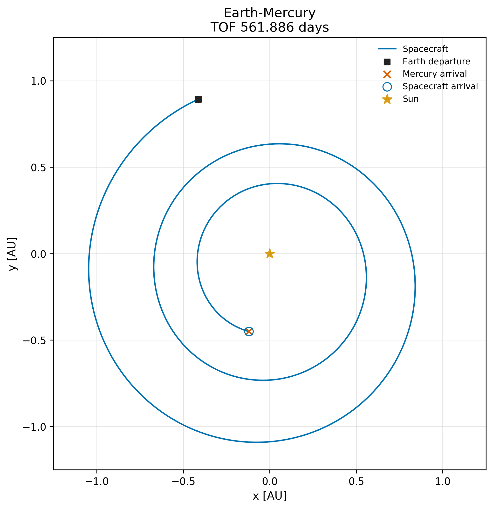

# Earth–Mercury: 561.886 days

The question: can I reduce time without allowing worse arrival errors than
the precise 576-day native reference?

| | Native reference | Local result |
|---|---:|---:|
| Flight time [days] | 576.000000 | **561.885720** |
| Position miss [km] | 62,990.003639 | **62,989.753870** |
| Velocity miss [m/s] | 63.027193526 | **63.024693303** |

**14.11428 days shorter**, inside the reference-quality arrival caps.

## What I used

- Ideal sail, 0.55 mm/s² at 1 AU; Sun-only gravity.
- Earth departure at MJD 52654.5; zero excess velocity.
- Fresh ENC seed 1, stopped after 200 complete evaluations.
- Full 600-day starting history; 600 held clock/cone commands.
- Restore at fixed time first, then reduce time with multiple shooting.
- Limit command-normal changes using the reference schedule.

```text
600 → 593.5 → 585.5 → 577.5 → 569.5 → 561.88572 days
```

One restoration, five time solves, four handovers. The handover count is what
this run needed. Ipopt reached local convergence inside the final
[561.5, 569.5]-day cell.

## Checks

Native replay starts from departure without resets to shooting nodes.
Maximum sampled difference between native replay and independent RK4-256:
**0.373397 m**. The Mercury miss is the kilometres row above.

The command-change check passed. The model uses held commands with instant
changes; attitude motion and actuator limits remain future work.



`inputs/`: selected schedule, departure and limits.
`native/`: recorded states, commands and final target.
`metrics.json`: numerical results, limits and recorded-run provenance.
